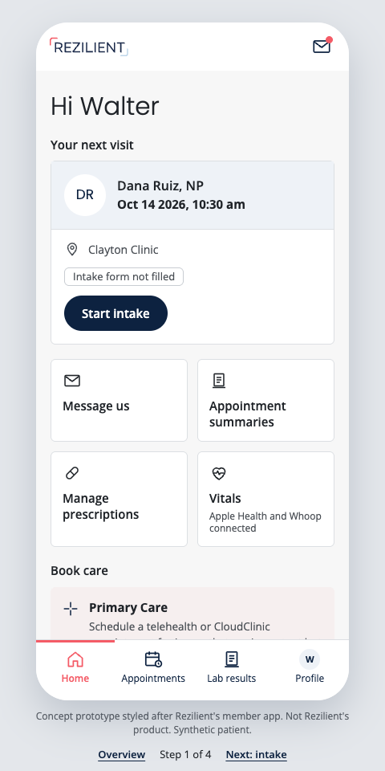
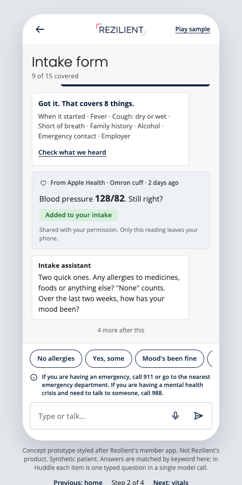
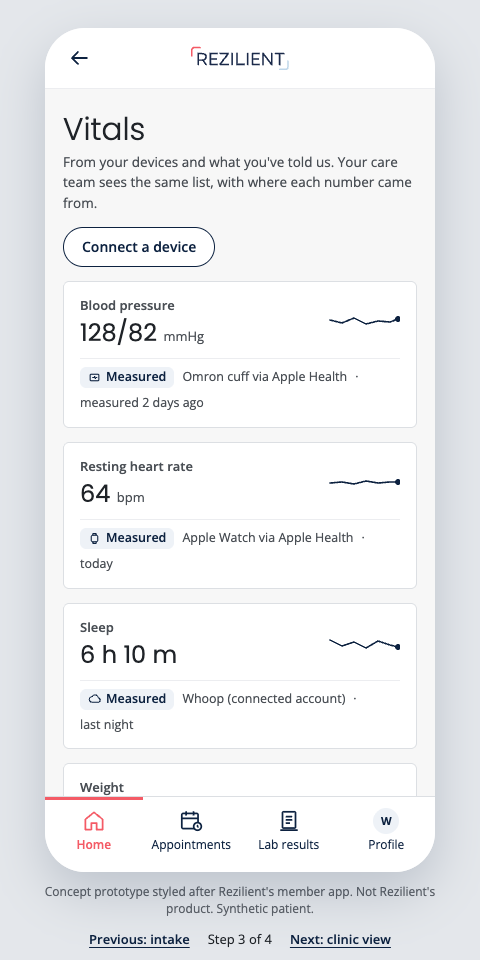
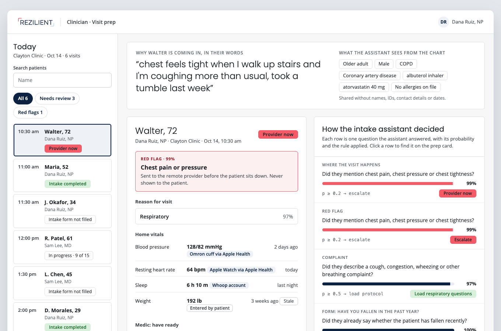

# Intake POC

Less paperwork for hybrid clinics, where a remote provider examines through an on-site medic. A working proof of concept for safe AI in a patient-facing health product: the model answers narrow questions, code makes every decision, and anything clinical goes to a clinician.

## Start here

| | |
|---|---|
| [Member app plan](docs/member-app-plan.md) | How I'd take a React Native member app native: per-screen calls, migration, release engineering, PHI on device, health data, AI safety |
| [Intake prototypes](docs/prototypes/) | One visit through the member app: home, intake in the member's own words, vitals with their sources, and the provider's view. Open `index.html` locally. |
| [Walkthrough](docs/walkthrough.md) | The product, the model choice and the reliability work |
| [Model evaluation](eval/RESULTS.md) | Ten model setups on 224 cases, pre-registered in [`eval/PREREGISTRATION.md`](eval/PREREGISTRATION.md) |

<p>
  
  
  
</p>


## What it demonstrates

| | Where |
|---|---|
| AI features with a safety boundary: typed questions, thresholds in code, escalations only to providers | `src/core/plan.ts`, `src/core/run.ts` |
| A tested fallback when the model is slow or down: the patient never sees an error | `src/core/breaker.ts`, `test/e2e.test.ts` |
| Measured model changes: pre-registered eval, shadow mode for upgrades | `eval/`, `src/core/shadow.ts` |
| PHI-safe telemetry: logs and metrics carry only allowlisted fields, and a test fails if patient data leaks | `src/api/log.ts`, `src/api/metrics.ts`, `test/e2e.test.ts` |
| Tests weighted to what agents get wrong: end to end with nothing mocked, the model boundary against the real pinned model, golden intakes recorded from it, and two unit tests | `test/` |
| Release discipline: error budgets with burn-rate and no-data alerts, a black-box probe, CI that scans config and images | `ops/slo`, `ops/prometheus`, `.github/workflows/ci.yml` |
| Learning from failure: a deliberate model outage, the bug it found, and the fix | `ops/postmortems/` |
| Built with coding agents under explicit rules, tests and CI gates | `AGENTS.md` |

A new patient normally fills out every field of an intake form. The POC reads what the chart already knows and what the patient already said, then asks only for the rest. Abridged output from one run; probabilities move a point or two between runs:

```
$ bun run demo maria "ear's been killing me 3 days, also need my lisinopril refilled"

Paperwork: 29 fields → 6 to type, 6 to confirm, 3 to sign
  Type
    Preferred pharmacy
    Have you had a fever?
    Which side is it: left, right, or both?
    ...
  Confirm (one tap)
    Medications you take now: lisinopril 10 MG Oral Tablet
    Do you smoke, vape or use tobacco?: Never smoker        ← recorded 2024, stale
    ...
  Already answered in their words
    Which medication do you need refilled?  (answered 100%)
    When did this start?                    (answered 100%)
  Prefilled from chart
    Full legal name, address, employer, member ID, PHQ-2 (recorded 2026) ...

Prep card
  setting     clinic
  complaint    96%  Medication refill
  complaint    95%  Ear, nose & throat
  devices     otoscope, exam_camera
```

What's left over becomes a prep card for the medic and provider: red flags, complaint, which devices and tests to have ready.

## How it works

```
FHIR R4 bundle ─► parseChart ─► Chart (code only, holds identifiers)
                                  ├─► prefill / confirm-if-stale / sign      (rules in code, dates in code)
                                  └─► toSummary ─► { ageBand, sex, problems, meds, allergies }
                                                         │
reason (patient's words) ──────────────┬─────────────────┤
                                       │                 ▼
                                       │   Decide (Jev): ~30 typed questions
                                       │     setting, red flags ×6, complaints ×6,
                                       │     "already answered?" per coverable field
                                       ▼                 │
                       Extract (Clairic, in parallel):   │
                       their own words per question      │
                                       └────────┬────────┘
                                   plan(): confidence gates in code (GATES)
                                     Jev decides every skip; Clairic only
                                     supplies "You said: 3 days" to confirm
                                                ▼
                                       patient form + prep card
```

- **Rules are code and data.** Paperwork fields live in `src/core/form.ts`, visit protocols in `src/core/protocols.ts`.
- **One model seam.** `Decide` turns the patient's words into probabilities. Jev ([TypeSafe](https://typesafe.ai)) is the default; the arena swaps in other models and approaches behind the same seam.
- **Degraded mode.** If the model is down or slow, prefill still works, every coverable question is asked, and a human triages.
- **Patient data stays narrow.** Models see the patient's own words plus `toSummary` (age band, sex, problems, meds, allergies), never names, IDs, contact details or dates. Logs are an allowlist of fields.

## Run

Full guide, with things to try and failure drills: [docs/quickstart.md](docs/quickstart.md).

```sh
bun install
export TYPESAFE_API_KEY=...
export CLOUDFLARE_ACCOUNT_ID=... CLOUDFLARE_API_TOKEN=...   # Clairic; or INTAKE_EXTRACTOR=none
bun run demo walter "chest feels tight when I walk up stairs"
bun run dev        # POST /v1/intake { reason, bundle, variant? }   GET /healthz
bun test           # calls the real model; without a key, e2e and integration skip
bun run golden:record   # after an intended plan change; review the diff
```

## Not for clinical use

Synthetic patients only. Fields and protocols are written for this demo and are not clinically validated. TypeSafe does not offer a HIPAA BAA, so real patient data must not be sent.
