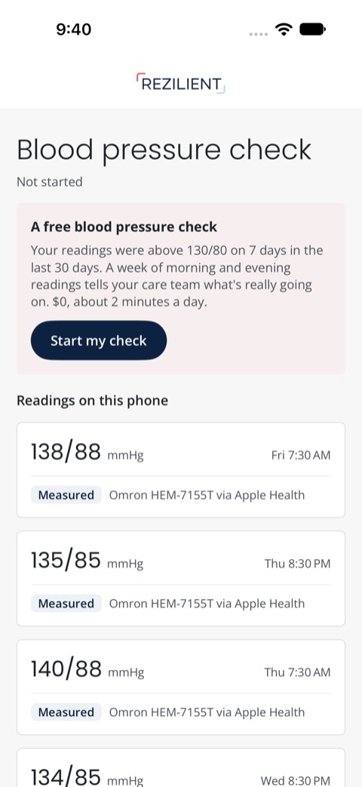
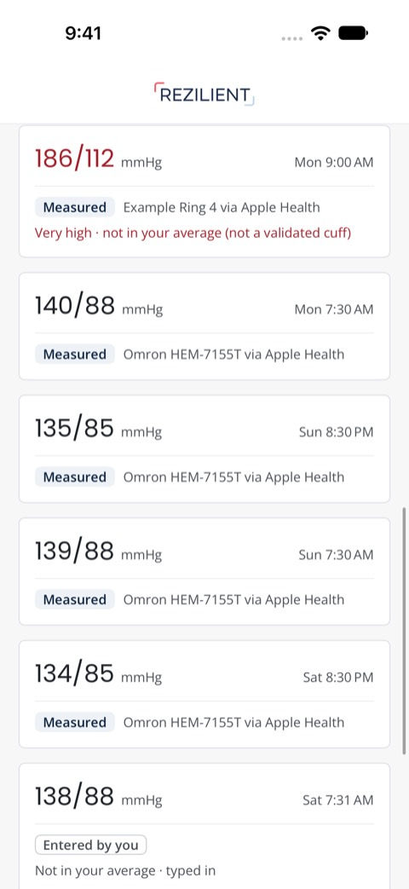
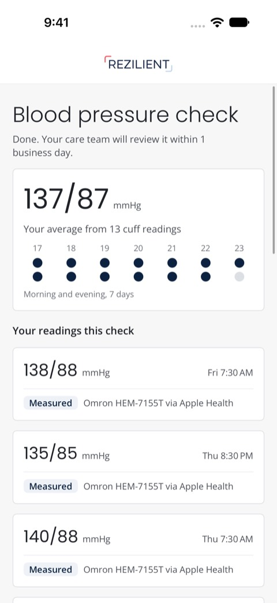
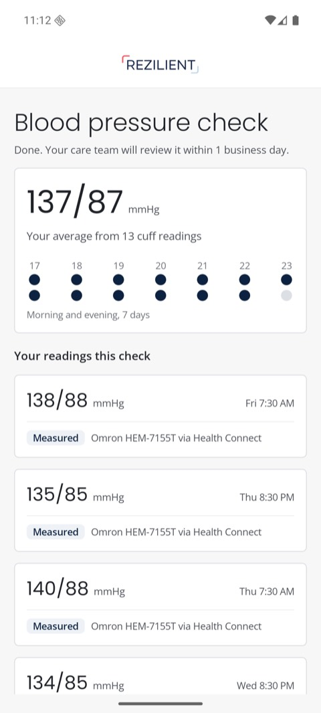

# BP pathway spike

A member's blood pressure week, from the health store on the phone to a care-team review. One data type, one pipeline, both platforms, no model in the loop. Synthetic data only.

| | |
|---|---|
| [Showcase](docs/showcase.html) | The 10-minute read: the bar every idea had to clear, the pathway, a member's week, the decisions and what was cut. Open it locally. |
| [Strategy](docs/strategy.md) | The full engineering plan: contract, HealthKit and Health Connect details, backend, privacy, failure modes, testing, rollout |

<p>
  
  
  
  
</p>

Screens from the iOS end-to-end test on a fresh simulator and an Android emulator reading Health Connect. Nothing mocked.

```
cuff app ─► HealthKit / Health Connect ─► HealthModule (Swift / Kotlin) ─► POST /v1/health/changes
                                            on-device: crisis check,          │
                                            history scan, anchor-on-ack       ▼
                                                                   server/src/rules.ts (classify,
                                                                   protocol math, derived state)
                                                                              │
                                                                              ▼
                                                                   care team: review, crisis tasks
```

## What it proves

| Claim | Where |
|---|---|
| The OS health store is the outbox: the anchor moves only after the server accepts a page | `ios/Sources/BPCore/SyncEngine.swift`, `ios/Tests/BPCoreTests/SyncEngineTests.swift` (mutation-checked) |
| A background wake during a foreground sync can't move the anchor backwards | same, `concurrentWakesTakeTurns` |
| Swift and the server agree on the crisis rule; Swift and Kotlin agree on the history scan | `goldens/*.json`, run by every suite |
| Only validated cuffs count; typed and unverified readings are shown, never averaged; a crisis counts from any source | `goldens/protocol.json`, `server/test/e2e.test.ts` |
| Nothing measured before the member opted in is accepted | `server/src/store.ts` (`before_enrollment`) |
| Resent pages are idempotent: no double counts, no second crisis task | `server/test/e2e.test.ts` |
| Deletions in Apple Health / Health Connect reach the average | e2e, tombstones |
| HealthKit specifics: read only blood pressure and `hypertensionEvent` (iOS 26.2+; one sheet, two topics), observe systolic (correlations can't be observed in the background), always call the observer's completion handler | `ios/Sources/HealthSync/HealthKitSource.swift` |
| The Swift and Kotlin clients and the TS server speak the same contract over a real socket | `ios/Tests/ContractTests`, `android/core/src/test/.../ContractTest.kt` |
| Health Connect specifics: changes token with the expired-token fallback, deletions as id-only tombstones, no history permission (entry B reads 30 days, Health Connect's default), the rationale activity-alias | `android/app/src/main/kotlin/dev/waits/bppathway/HealthConnectSource.kt`, `AndroidManifest.xml` |
| The iOS app, end to end with nothing mocked: seed HealthKit, both permission sheets (iOS 27's history step answered "Past 30 Days"), history-scan invite, clinician enroll, sync, exclusions on screen, one crisis task | `ios/App/UITests/PathwayUITests.swift`, on a new simulator each `./check.sh` |
| All three entries reach the same week: history scan on the phone (B), clinician enrolls (C). A's permission is in the same sheet; its reader needs a real Watch, because only Apple writes `hypertensionEvent` | `POST /v1/bp-pathway/enroll`, `POST /v1/care/members/:id/enroll` |

## Run

```
./check.sh          # server tests + typecheck + lint, Swift + Kotlin tests, both clients ↔ server contract, iOS UI e2e, Android build (~4 min)
cd server && bun run dev                          # :3100
cd android && ./gradlew :app:installDebug         # emulator reaches the server at 10.0.2.2
cd ios/App && xcodegen generate                   # then run BPPathway on a simulator
```

## Look

Both apps use the intake POC's look ([`docs/prototypes`](../docs/prototypes/)), which is styled after Rezilient's member app as it appears in its App Store screenshots: the wordmark bar, Poppins and Open Sans (both OFL, licenses in `ios/App/Fonts`), bordered cards, navy pills, and "Measured" / "Entered by you" provenance chips. This is a concept, not Rezilient's product.

## Not here (yet)

- Background delivery on a real iPhone (the Simulator never delivers).
- Entry A's reader: the simulator can't produce a hypertension notification.
- Auth (spike sends `x-member-id`), FHIR output, cuff fulfillment, the care-team UI.

## Config

`config/pathway.json` is clinical config: thresholds, protocol windows, the cuff allowlist. Every value in it is a proposal for the clinical lead, not a clinical decision.
