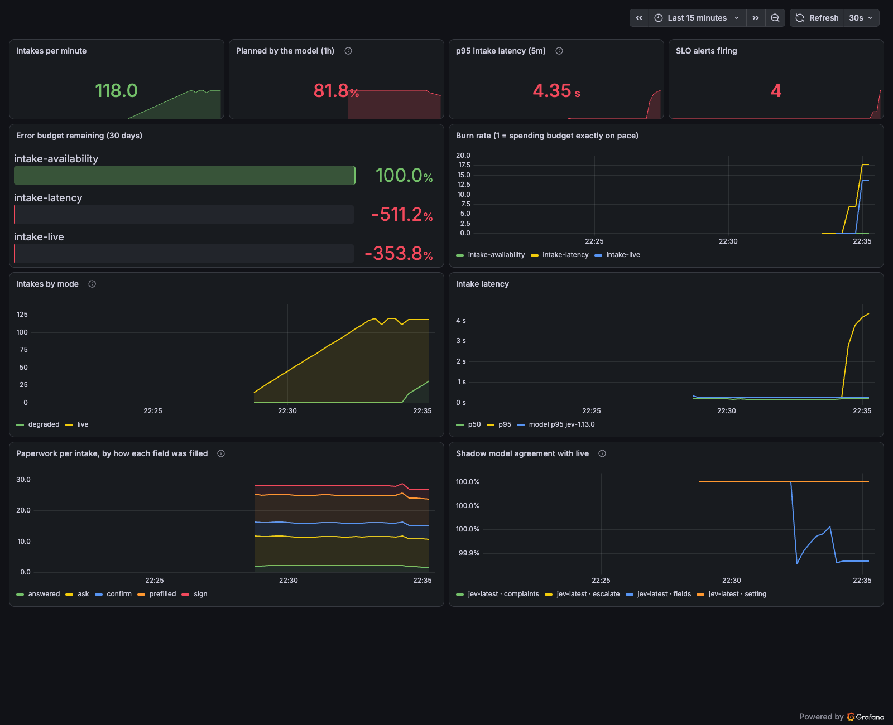
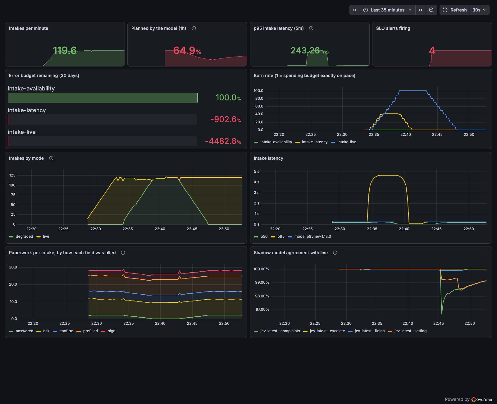

# Walkthrough

Intake paperwork for a CloudClinic visit, cut down to what nobody already knows. A working example of AI in a patient-facing product: measured against nine alternatives, safe when the model fails, and built with release discipline. TypeScript, Bun and Hono, synthetic patients only.

1. [The product](#the-product)
2. [How it works](#how-it-works)
3. [Which model](#which-model)
4. [Running it like a production service](#running-it-like-a-production-service)
5. [Game day](#game-day)
6. [Open items](#open-items)

## The product

**A new patient answers 6 questions instead of 29.** Before the visit, the POC reads two things it already has: the chart, and the patient's own words about why they're coming in. It fills, confirms or skips every field it can, and asks only what's left. What remains becomes a prep card for the on-site medic and the remote provider.

Each field ends up as one of: prefilled from the chart, confirm with one tap, sign, already answered in their own words, or ask.

| Patient | In their words | Fields | Type | Confirm | Sign | Already answered | Prefilled |
|---|---|---|---|---|---|---|---|
| Maria, 52 | "ear's been killing me 3 days, also need my lisinopril refilled" | 29 | **6** | 6 | 3 | 2 | 12 |
| Walter, 72 | "chest feels tight when I walk up stairs … took a tumble last week" | 27 | **14** | 3 | 3 | 1 | 6 |

Maria's chart is rich, so most of the form disappears. Walter's has no email, coverage or allergies on file, so he types more. How much the POC saves depends on how complete the chart already is.

Walter's prep card:

| | |
|---|---|
| Setting | **Provider now** |
| Red flag | Chest pain or pressure, 99% |
| Complaint | Respiratory, 97% |
| Medic preps | stethoscope, pulse oximeter, standard vitals |
| Fall screen | answered by "took a tumble last week" |

The remote provider's minutes are the scarce resource. Every history question the patient answers ahead of time, and every device the medic has ready, is time the provider spends examining instead of asking. Red flags reach a provider before the patient sits down, and escalations go to providers, never to patients.

## How it works

**One model call, with every rule kept in code.** The model answers narrow questions with probabilities. Code decides what to do with them, which makes the result testable, auditable and swappable.

| Step | What happens | Where |
|---|---|---|
| 1. Read the chart | FHIR R4 bundle → `parseChart()` | [`src/core/chart.ts`](../src/core/chart.ts) |
| 2. Strip it down for the model | `toSummary()`: age band, sex, problems, meds, allergies. No names, IDs, contact details or dates. The model also sees the patient's own words | [`src/core/chart.ts`](../src/core/chart.ts) |
| 3. Ask about 30 typed questions at once | One Jev call: setting, 6 red flags, 6 complaints, "already answered?" per field. About 180 ms p95 | [`src/core/run.ts`](../src/core/run.ts) |
| 4. Apply the gates | `plan()`: escalate at p ≥ 0.2, skip a question only at p(answered) ≥ 0.7 | [`src/core/plan.ts`](../src/core/plan.ts) |
| 5. Return the form and the prep card | `POST /v1/intake`. Every model-driven item carries its question, probability and rule | [`src/api/server.ts`](../src/api/server.ts) |

- **Safe when the model fails.** Prefill still works, every question is asked, and a navigator triages. The patient never sees an error.
- **No patient data in logs.** Log fields are an allowlist checked by the compiler, and a test fails if the complaint or a name ever appears ([`src/api/log.ts`](../src/api/log.ts)).
- **Dates and math stay in code.** Ages, stale-record checks and thresholds never go to the model.

## Which model

**Jev won a pre-registered comparison against nine alternatives, under a labeled amendment to the rule.** Same cases, same scoring code, paired statistics, and the decision rule written down before anything ran. Full results, including the amendment and every arm: [`eval/RESULTS.md`](../eval/RESULTS.md).

| | |
|---|---|
| Cases | 224: 179 synthetic and 45 triage vignettes |
| Labeled form fields | 892 |
| Arms | 10: decision models, general LLMs, rules |
| Arena spend | $3.80 of a $50 cap |

| Arm | Paperwork accuracy | Emergent vignettes caught | p95 latency | $ per 100k intakes | Self-host |
|---|---|---|---|---|---|
| **Jev** (TypeSafe) | **99.3%** | **87.5%** | **181 ms** | $9 | no |
| Clef 27B (Cloudflare) | 98.7% | 37.5% | 1.3 s | $75 | yes |
| Clef-flash 9B (Cloudflare) | 96.9% | 75.0% | 765 ms | $28 | yes |
| Kev-4B (laptop GPU) | 93.8% | 62.5% | 5.5 s | $0 | yes |
| Haiku 5.5, typed | 98.9% | 75.0% | 4.1 s | $89 | no |
| GPT-6 Luna, typed | 98.7% | 75.0% | 2.7 s | $32 | no |
| Opus 5.5, one prompt | 97.3% | 50.0% | 3.8 s | $736 | no |

Test split, amended rule. Five arms are statistically tied on accuracy; the pre-registered tiebreak takes the one under one second, then the cheapest. Every arm passed the red-flag guardrail except rules only and Haiku with one prompt.

- **Labels known by construction.** Code chooses which facts each message states, a model that isn't competing writes it, and a second one checks it. No arm grades its own family's writing.
- **The deviation.** The rule as first written tuned the escalation threshold on 20 dev cases and pushed Jev's to 0.98, after which it escalated 17 of 18 red-flag test cases. The result is kept, with a labeled amendment: safety thresholds are never tuned upward on a few examples.
- **Clef is the real alternative.** Tied on paperwork, identical answers on every repeat, and it can be self-hosted. It caught 3 of 8 emergent vignettes against Jev's 7.

## Running it like a production service

| Piece | What it does | Where |
|---|---|---|
| Uptime targets | Answered without a server error 99.9%, under 1 second 99%, planned by the model rather than the fallback 99%. Sloth generates 51 Prometheus rules with fast and slow burn-rate alerts. Each SLI also has a no-data alert, and a black-box probe alerts when the service stops answering from outside | [`ops/slo/intake.sloth.yaml`](../ops/slo/intake.sloth.yaml), [`ops/prometheus/rules/`](../ops/prometheus/rules/) |
| Observability | Prometheus metrics with no patient data in any label, a Grafana dashboard, and runbooks linked from every alert | [`src/api/metrics.ts`](../src/api/metrics.ts), [`ops/grafana/`](../ops/grafana/), [`ops/runbooks/`](../ops/runbooks/) |
| Shadow mode | A candidate model sees a sample of real traffic after each response and never affects a patient. Agreement is tracked per decision, so a model upgrade is a measured change | [`src/core/shadow.ts`](../src/core/shadow.ts), `INTAKE_SHADOW_DECIDER=jev:jev-latest` |
| Circuit breaker | After 5 straight model failures, skip the model for 30 seconds and serve the safe plan in milliseconds. One trial call closes it again | [`src/core/breaker.ts`](../src/core/breaker.ts), `intake_breaker_open` |
| CI | Tests, lint, types, rule drift, rule unit tests, and Trivy scans of config and image on every change | [`.github/workflows/ci.yml`](../.github/workflows/ci.yml) |

## Game day

**We cut the model off on purpose. No intake failed, and it found a real bug.** Two intakes per second of synthetic traffic, then the model endpoint pointed at an address that never answers. Full write-up: [`ops/postmortems/2026-10-09-game-day-jev-outage.md`](../ops/postmortems/2026-10-09-game-day-jev-outage.md).

| Time (UTC) | Event |
|---|---|
| 03:27 | Traffic starts. Shadow model on 20%. |
| 03:31 | Pre-check finds two SLO queries returning no data while healthy. Fixed before the outage. |
| 03:33:46 | **Model outage begins.** |
| 03:35:09 | Degraded-plan and latency alerts fire, 83 seconds in. |
| 03:35:45 | Fix deployed mid-outage: 400 ms timeout and circuit breaker. |
| 03:35:59 | Degraded plans in 10 to 20 ms instead of 4.5 s. |
| 03:42:25 | **Model restored**, live plans at 215 ms. |

What we learned:

- **The timeout was longer than the latency target.** 2 seconds plus a retry meant an outage made every intake take 4.5 s. It's now sized from Jev's measured p99 (245 ms).
- **Two ways an SLO goes blind.** Prometheus 3 rewrites `le="1"` to `le="1.0"`, and zero errors means no error series at all. CI now catches rule drift, and each SLI has a no-data alert.
- **Server metrics can't see a dead process.** Container restarts never reached the service's counters. A black-box probe now alerts on that.

*During the outage: p95 at 4.35 s, burn rates spiking, four alerts firing.*

*After: burn rates back to zero. The "answered in their own words" band drops to zero during the outage, as degraded mode should.*

**Rerun on 9 Oct, after the fix.** The same outage, started without a healthy baseline. The degraded-plan page alert became active 57 seconds after the outage began and was firing at the next check, the breaker held p95 intake latency at 48 ms, all 395 intakes during the outage got the degraded plan, and live plans were back within about 30 seconds of the restore. Details are in the postmortem.

## Open items

Done since the first write-up:

- **No-data alerts and a black-box probe:** [`ops/prometheus/rules/intake-guards.yml`](../ops/prometheus/rules/intake-guards.yml), with rule tests in [`ops/prometheus/tests/`](../ops/prometheus/tests/).

Still to do:

- **Hand-check the labels.** Review 30 sampled cases with `bun run eval:review` and report the error rate, as the pre-registration says.
- **A fair self-hosted test.** Kev-27B or Clef weights on a datacenter GPU, for teams that can't send patient data to a vendor.
- **Tune complaint routing.** Jev flags extra complaints, adding about 0.8 unneeded questions per patient.
- **Real forms.** The fields and protocols are a demo. A clinic's actual intake forms would make the savings real.

---

Synthetic patients only, not for clinical use. TypeSafe offers no public BAA, so no real patient data was sent anywhere.
